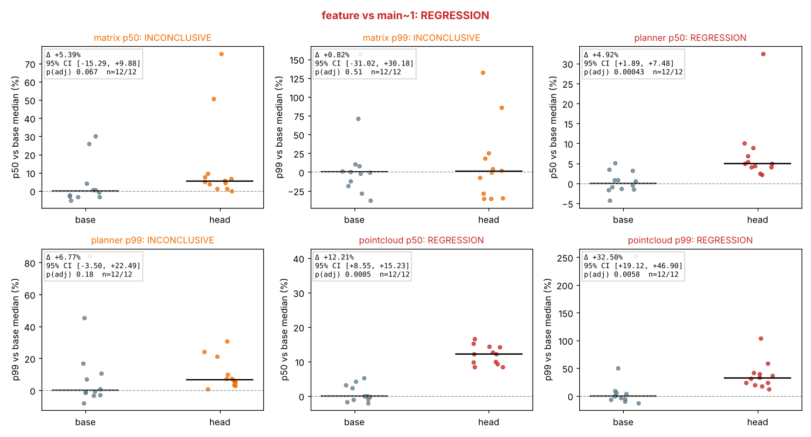

# BenchGate: performance regression benchmarking platform

Every commit runs a benchmark suite on a fleet of bench nodes. A
statistically sound check blocks merges that make the code slower.

The workloads mimic the hot loops of an autonomy stack: point-cloud
filtering, A* planning, and a Kalman-style matrix update. The C++
benchmarks, Python orchestrator, Kubernetes executor, statistics, CI gate,
dashboards, node-tuning kit and capacity model all live in this repository.



*A real verdict from this repo's own pipeline: an 8% slowdown injected into
"head", run paired (ABBA) on one pinned CPU of the dev sandbox, 12 runs per
side. Planner p50 and both pointcloud metrics are flagged and then confirmed
by a second batch. Matrix was flagged in the first batch, but the
confirmation batch was hit by contaminated runs (the +25% to +75% points;
this shared VM loses whole runs to its neighbours), so matrix is reported as
inconclusive rather than blocked. That is the confirmation step doing its
job.*

## Results (real numbers, reproducible)

| | False alarms (A/A) | 2% regression | 5% | 10% |
|---|---|---|---|---|
| Tuned bare metal (noise model) | 0.1% (1/1000) | **100%** | 100% | 100% |
| Untuned cloud VM (noise model) | 0.9% (9/1000) | 38% | 99% | 100% |
| **Real workloads + real injected slowdowns** on the dev sandbox (shared VM) | **0.8% (5/600)** | 4% | 32% | 66% |
| With confirmation re-run (tuned / untuned) | **0/5000** each | 100% / 16% | 100% / 98% | 100% / 100% |

All rows use 10 runs per side, a gate at α = 1% (Holm-corrected), a minimum
effect of 1%, and a 95% BCa CI. The real-workload false-alarm rate across
200 clean comparisons per workload: matrix 1/200, planner 2/200, pointcloud
2/200.

* **Node tuning matters more than node count.** The same gate goes from 38%
  to 100% detection of a 2% regression.
* **Pair base and head on one node.** Unpaired comparisons across an 8-node
  fleet produced 76 false flags per 1000 commits; paired, 8.
* **Run many short processes, not a few long ones.** Same node-time: 30×100
  iterations detects 2% in 84% of cases, 5×600 in 13%.
* **History analysis catches creep.** Ten commits each 0.5% slower: the
  pairwise gate catches it 22% of the time, PELT 100% with ~0 false flags.
* **Capacity.** Under $6k/month, run 8 tuned nodes with 8 runs per side:
  p95 peak CI wait 22 min at 29% utilization. Untuned VMs would need 18
  nodes for 74% power at 2%.

Details: [`docs/statistics.md`](docs/statistics.md),
[`docs/capacity.md`](docs/capacity.md),
raw tables in [`docs/results/`](docs/results/).

## Stages

| # | Stage | Where | Status |
|---|---|---|---|
| 0 | Design doc: noise sources, what makes a regression real, fleet sizing | [`docs/design.md`](docs/design.md) | done |
| 1 | C++ workloads (CMake, per-iteration JSON, `--slowdown-mode uniform\|tail`) | `workloads/` | done, ctest |
| 2 | Runner + orchestrator: retries, timeouts, node leases; K8s Jobs for kind and GKE | `benchgate/{runner,orchestrator,executors,lease}.py`, `deploy/` | done; K8s verified with kubeconform + fake API server; **kind e2e runs in CI** (kind cannot run in the dev sandbox) |
| 3 | Trace capture (perf / bpftrace / fallback) + streaming C++ trace parser | `benchgate/trace/`, `workloads/tools/trace_parser.cpp` | done; perf/bpftrace are unavailable in the sandbox and skipped with recorded reasons |
| 4 | Storage (DuckDB default, BigQuery optional) + Grafana dashboards | `benchgate/storage/`, `dashboards/` | done; every DuckDB dashboard query is executed in tests |
| 5 | Statistics: bootstrap, Mann-Whitney U, PELT, CUSUM; detection simulation | `benchgate/stats/`, `benchgate/sim/` | done, numbers above |
| 6 | CI gate: GitHub Actions, merge-blocking check run with verdict and plot | `.github/workflows/benchgate.yml` | done |
| 7 | Node tuning kit: Ansible, systemd, `measure_variance.sh` | `tuning/` | done; **before/after on real hardware PENDING**, exact commands in [`tuning/README.md`](tuning/README.md) |
| 8 | Capacity model: queueing simulation + recommendation | `benchgate/capacity/`, [`docs/capacity.md`](docs/capacity.md) | done, validated against Erlang C |

## Quick start

```bash
# Build the workloads and install the package
cmake -S workloads -B workloads/build -DCMAKE_BUILD_TYPE=Release && cmake --build workloads/build -j
(cd workloads/build && ctest)
pip install -e ".[dev]"
pytest -q

# One workload, with and without an injected 5% tail regression
workloads/build/benchgate_workloads --workload planner --iterations 500 | head -c 300
workloads/build/benchgate_workloads --workload planner --slowdown-mode tail --slowdown-pct 5 | head -c 300

# The whole gate in-process: paired ABBA runs on one pinned CPU, verdict, plot
benchgate gate-local --base A --head B \
  --base-binary workloads/build/benchgate_workloads --head-binary workloads/build/benchgate_workloads \
  --inject-mode uniform --inject-pct 10 --out verdict.json --plot verdict.png

# The service (local executor: CPU sets as "nodes"; DuckDB store)
benchgate serve --executor local --local-nodes "n0=2;n1=3" --store duckdb://benchgate.duckdb &
curl -XPOST localhost:8080/compare -d '{"base":"A","head":"B","workloads":["matrix"],"repetitions":10}'
benchgate gate --service http://localhost:8080 --base A --head B --workloads matrix

# On a cluster
./deploy/kind/e2e.sh                       # kind: 2 bench nodes, real Jobs and Leases
./deploy/gke/create-cluster.sh             # GKE: tainted bench pool, SMT off, static CPU manager
```

Making the check blocking: in repository settings, add a rule that
requires the status check **`BenchGate`**. Without a `BENCHGATE_URL`
secret, the workflow runs the gate on the Actions runner (noisy: a demo,
not a measurement). With it, the workflow pushes images for base and head
and the fleet runs paired jobs on tuned nodes.

## Layout

```
workloads/          C++ benchmarks, harness, trace_parser, ctest
benchgate/
  runner.py         one job on one node: N reps (paired ABBA), checksum, fingerprint
  orchestrator.py   queue, leases + heartbeat, retries with backoff, deadlines
  executors.py      LocalExecutor, KubernetesExecutor (+ bench Job manifest)
  lease.py          SQLite and coordination.k8s.io Lease backends (CAS)
  stats/            mannwhitney, bootstrap (BCa), gate (Holm), changepoint (PELT, CUSUM)
  sim/              noise model, data collection, detection + history simulations
  capacity/         queueing simulation
  trace/            perf/bpftrace/fallback capture
  storage/          DuckDB and BigQuery
  service.py api.py cli.py github_check.py plots.py dashboards.py
deploy/             kind config + e2e, kustomize base/overlays, GKE cluster script
dashboards/         generated Grafana JSON (duckdb, bigquery) + local provisioning
tuning/             Ansible role, systemd units, measure_variance.sh
data/calibration/   960 real runs from the dev sandbox (noise-model calibration)
docs/               design, statistics, capacity, kubernetes, results/
```
